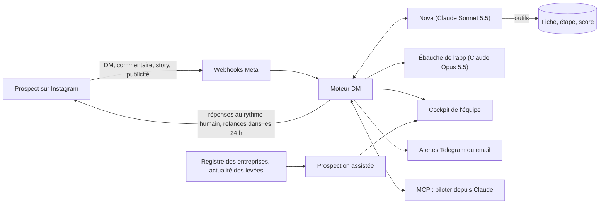

# Moteur DM de YD Studio

Le moteur maison des DM Instagram de YD Studio : **Nova**, une IA qui accueille les personnes qui écrivent au studio, comprend leur projet d'app, vérifie le budget, fait préparer une première ébauche de leur app et cale un appel de 10 minutes avec l'équipe. Sans ManyChat, sans n8n, et dans les règles d'Instagram.

- **Tester l'IA tout de suite** (dans Claude, sans clé ni installation) : [Labo Nova](https://claude.ai/artifact/BFT3Pjiq2m8MEDcKbLg54k)
- **Voir le cockpit avec des données fictives** : `npm install && npm run demo`, puis http://localhost:3999/cockpit
- **Documentation** : [docs/](docs/01-demarrage.md)

## Comment ça marche

1. **Avant** : chaque matin, le moteur repère des prospects dans des sources publiques, leur donne un score et rédige une accroche ; un humain l'envoie depuis l'app.
2. **Pendant** : Nova répond aux DM, aux commentaires « APP », aux réponses de stories et aux publicités. Elle se présente comme une IA, découvre le projet, pose la question du budget (à partir de 5 000 €, en plusieurs fois), lance l'ébauche et propose l'appel. Le rythme est humain : regroupement des messages, lecture, indicateur de saisie, bulles courtes.
3. **Après** : relances utiles dans la fenêtre de 24 h, résumé de chaque conversation pour l'équipe, relance manuelle prête à copier, bilan chaque lundi.

## Ce qui est prêt

| Partie | État |
| --- | --- |
| Nova : prompt maître v2, base de connaissances du studio, 7 outils, score et fiche prospect | Prêt, évalué à l'aveugle (Sonnet 123/140, Opus 124/140, Haiku 118/140) |
| Moteur : webhooks signés, file de tâches, rythme d'envoi, fenêtre de 24 h, relances, reprise par un humain | Prêt et testé |
| Ébauches : brief et 3 écrans iPhone générés par Opus 5.5, rendus en image | Prêt |
| Cockpit : tableau de bord, conversations, prospects, ébauches, bac à sable, réglages | Prêt |
| Prospection assistée : registre des entreprises, flux d'actualité, score, accroches | Prête |
| Alertes : Telegram, email, webhook ; bilan hebdomadaire ; alerte de budget IA | Prêtes |
| Serveur MCP (12 outils) | Prêt |
| Labo Nova (test de l'IA dans Claude, avis enregistrés) | Publié |
| Déploiement : Dockerfile, docker-compose (moteur, Postgres, HTTPS), diagnostic `npm run doctor` | Prêt |
| Connexion au compte Instagram | À faire avec l'équipe : [guide](docs/02-connexion-instagram.md) |

Tests : `npm test` (base de données, moteur de bout en bout, HTTP, logique de l'IA, Labo).

## Ce qu'il faut pour passer en production

1. Une clé API Claude (console.anthropic.com) avec un plafond de dépense.
2. L'app Meta et le jeton du compte Instagram du studio : [guide pas à pas](docs/02-connexion-instagram.md).
3. Un petit serveur (5 à 10 € par mois) et le sous-domaine `moteur.yd-studio.fr` : [guide](docs/03-deploiement.md).
4. Le lien de réservation de l'appel de 10 minutes (Calendly ou Cal.com).
5. Un canal d'alertes (bot Telegram conseillé).
6. Une section « Messages Instagram et IA » dans la politique de confidentialité du site.

Puis `npm run doctor` pour tout vérifier, une semaine en `DRY_RUN=true`, et c'est parti.

## Règles non négociables

1. **API officielle de Meta uniquement** : pas de mot de passe, pas de scraping, pas d'abonnement ni de premier DM automatique à un inconnu.
2. **Messages automatiques seulement quand c'est permis** : dans les 24 h qui suivent le dernier message de la personne, et un seul DM par commentaire.
3. **Nova dit qu'elle est une IA** (AI Act, article 50) et passe la main à un humain dès qu'on le demande.
4. **RGPD** : données minimales, opposition et effacement à tout moment.

Le détail et les raisons : [docs/06-regles-et-conformite.md](docs/06-regles-et-conformite.md).

## Documentation

1. [Démarrer](docs/01-demarrage.md)
2. [Connecter Instagram](docs/02-connexion-instagram.md)
3. [Déployer le moteur](docs/03-deploiement.md)
4. [Utiliser le moteur au quotidien](docs/04-utilisation.md)
5. [L'IA et ses coûts](docs/05-ia-et-couts.md)
6. [Les règles d'Instagram, l'AI Act et le RGPD](docs/06-regles-et-conformite.md)
7. [Faire venir les bons prospects en DM](docs/07-strategie-instagram.md)

Le questionnaire de cadrage du projet reste disponible : https://claude.ai/artifact/KvscPJYpqortLYZGGroG1f
